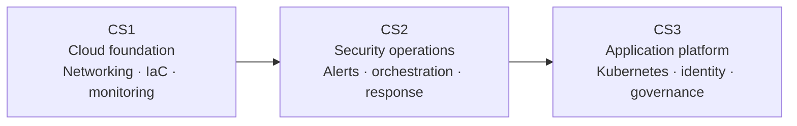
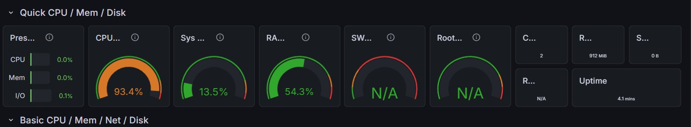
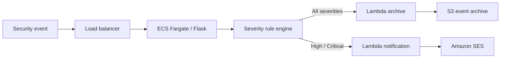
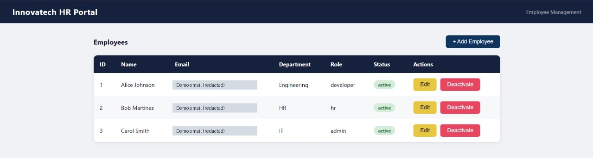

# Cloud Network Automation | AWS, SOAR & Kubernetes

**Görkem Deniz Arslan · HBO-ICT, Fontys University of Applied Sciences · 2026**

An individual cloud engineering project that progresses from designing and automating a secure AWS network to developing an automated security response service and a containerized employee lifecycle platform.

The three case studies follow a fictional growing organization, Innovatech Solutions. Each addresses a different infrastructure or operational challenge: building a reliable foundation, automating security operations, and supporting employee management at scale.

## Project overview

| Case study | Engineering challenge | Main technologies |
| --- | --- | --- |
| [CS1 — Cloud infrastructure](#case-study-1--aws-network-infrastructure--observability) | How can application infrastructure be securely segmented, provisioned automatically and monitored? | AWS, Terraform, VPC Peering, EC2, RDS, Route 53, Prometheus, Grafana |
| [CS2 — Security automation](#case-study-2--security-orchestration-automation-and-response-soar) | How can security alerts be processed automatically and trigger appropriate response actions? | ECS Fargate, Flask, ECR, Lambda, SES, S3, GitHub Actions |
| [CS3 — Employee lifecycle](#case-study-3--employee-lifecycle--hr-platform) | How can a small organization manage employee records and automate identity lifecycle operations while controlling infrastructure costs? | FastAPI, PostgreSQL, Docker, Kubernetes, IAM Identity Center, CloudWatch, SSM |



Each phase is a separate implementation snapshot, not a single system deployed simultaneously.

## Case Study 1 — AWS Network Infrastructure & Observability

The first phase focused on providing a secure and manageable cloud foundation for a web application. Instead of placing all resources in one public network, I designed a hub-and-spoke topology and separated internet-facing, application and database resources.

**What I implemented**

- Two interconnected VPCs using private VPC peering, with a bastion host for administrative access.
- Public and private subnets across two availability zones, route tables, Internet and NAT gateways, and security groups controlling traffic between tiers.
- An Application Load Balancer distributing requests to Nginx web servers in an EC2 Auto Scaling Group.
- A private RDS MySQL database with internal Route 53 DNS resolution.
- Infrastructure provisioning using Terraform, along with Prometheus, Node Exporter and Grafana for infrastructure visibility.

**Outcome:** the original semester report records the network configuration and working monitoring dashboards, including changes in target availability and CPU metrics. This phase established the foundation for cloud networking, infrastructure as code and troubleshooting.



[Source code](case-study-01/) · [Architecture and validation](docs/case-study-01.md)

## Case Study 2 — Security Orchestration, Automation and Response (SOAR)

The second phase introduced a security automation service alongside an independently managed application infrastructure. The objective was to turn incoming security events into consistent, severity-based responses without requiring manual action for every alert.

The SOAR processor was developed as a Python Flask API, packaged using Docker and designed for AWS ECS Fargate. An Application Load Balancer receives alerts and routes them to the container. The rule engine invokes AWS Lambda functions asynchronously: the intended response archives every alert in S3, while high and critical alerts also request an email notification through Amazon SES.



**What I worked on**

- Independent Terraform stacks for the SOAR service and the application/monitoring environment.
- Python alert processing and rule-based response logic.
- Container registry and deployment automation using ECR and GitHub Actions.
- Lambda handlers for event archiving and notifications, and infrastructure monitoring through Prometheus and Grafana.

**Outcome:** the semester tests verified Terraform configuration and several infrastructure components. End-to-end SOAR validation remained incomplete due to ECS image retrieval and runtime issues, including an ALB 503 response. The later portfolio revision hardens the alert API, input validation, HTTPS configuration and permissions, but it has not been redeployed to AWS.

[Source code](case-study-02/) · [Architecture, event flow and test results](docs/case-study-02.md)

## Case Study 3 — Employee Lifecycle & HR Platform

The final phase focused on combining application development with infrastructure automation, container orchestration, identity management and cloud governance. I developed a lightweight HR portal to manage employee records and separate automation scripts intended to support onboarding and offboarding.

**What I implemented**

- A FastAPI REST backend, browser-based frontend served by Nginx, and PostgreSQL for persistent employee records.
- Employee creation, viewing, editing and deactivation without deleting historical records.
- Docker images and Kubernetes deployments, services, persistent storage, resource probes, network policies, RBAC and HPA configuration.
- Python scripts for onboarding and offboarding through AWS IAM Identity Center, with group assignment and database recording.
- Terraform definitions for supporting AWS networking, IAM, ECR, SSM configuration and budget alerts, along with CloudWatch dashboard configuration and Fluent Bit manifests.

The original managed AWS design included EKS and RDS. Because of AWS student-account restrictions and cost considerations, I adapted the runnable environment to Minikube and in-cluster PostgreSQL instead. This provided a practical way to demonstrate the application and Kubernetes behavior without claiming that the managed design was deployed.

**Outcome:** the original report recorded 17 successful test cases and two not applicable due to account restrictions. Employee management, persistence after restart and Kubernetes pod recovery were demonstrated; live IAM Identity Center user provisioning and RDS failover were not verified. The later revision also includes demo-level administrator/read-only authorization and improved database network policies.



[Source code](case-study-03/) · [Architecture, validation and cost analysis](docs/case-study-03.md) · [Kubernetes pod recovery evidence](docs/images/cs3-pod-recovery.jpg)

## Engineering decisions & learning

- **Network isolation:** separate public and private resources and restrict management access rather than exposing every service directly.
- **Automation:** define infrastructure through Terraform and retain CI/CD workflow references for repeatability.
- **Security operations:** use rule-based processing and serverless actions to model automated incident response.
- **Operational resilience:** use load balancing, auto-scaling, health checks, persistent storage and Kubernetes-managed pod replacement.
- **Cost awareness:** choose a local Kubernetes cluster where managed services are unavailable or unnecessarily expensive for a student lab.
- **Validation:** document successful, incomplete and environment-blocked tests instead of treating every designed feature as deployed.

## Repository structure

```text
case-study-01/   AWS network infrastructure and observability
case-study-02/   SOAR application and AWS infrastructure
case-study-03/   HR application, Kubernetes and AWS support infrastructure
docs/            Architecture, historical test reports and screenshots
tests/           Offline regression checks
```

The original semester evidence is documented separately from later maintenance and security improvements. The screenshots are cropped from original reports and do not show the later hardened versions.

Run the offline regression checks with:

```bash
python -m unittest discover -s tests -v
```

No active CI workflow provisions AWS resources. Historical deployment workflows are kept as inactive references. These projects are educational implementation snapshots, not production-ready services; review account configuration, credentials, security requirements and cloud costs before deployment.

See [portfolio notes](docs/portfolio-notes.md) for source provenance, security changes and testing scope.
