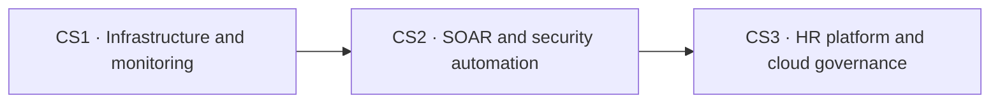

# Cloud Network Automation — AWS, SOAR & Kubernetes

**Görkem Deniz Arslan · Fontys University of Applied Sciences · 2026**

An individual cloud engineering portfolio following a fictional growing company, Innovatech Solutions, through three successive infrastructure and automation case studies.

| Case study | Focus | Technologies |
| :--- | :--- | :--- |
| [01 — Cloud infrastructure](docs/case-study-01.md) | Segmented AWS networking, three-tier architecture, observability | Terraform, VPC Peering, EC2, ALB, RDS, Route 53, Prometheus, Grafana |
| [02 — Security automation](docs/case-study-02.md) | Alert intake, severity-based automated response, independent infrastructure stacks | ECS Fargate, ECR, Flask, Lambda, SES, S3, GitHub Actions |
| [03 — Employee lifecycle](docs/case-study-03.md) | Containerized HR portal, identity lifecycle automation, Kubernetes and governance | FastAPI, PostgreSQL, Minikube, Kubernetes, IAM, CloudWatch, SSM, AWS Budgets |



## Project evidence

**CS1 — Monitoring dashboard (original semester evidence)**


**CS3 — Employee management portal (original semester evidence)**


The screenshots are cropped from original project reports to remove unrelated identifiers and browser/workstation details. They show the historical implementation, not the later hardening changes.

## Technical highlights

- AWS network segmentation, private database access, bastion administration, load balancing, and internal DNS.
- Terraform infrastructure as code and CI/CD workflow design.
- Serverless security response: route alerts to Lambda, archive them in S3, and send high-severity notifications through SES.
- HR REST API, containerized frontend, persistent PostgreSQL, Kubernetes RBAC, resource probes, network isolation, and autoscaling configuration.
- Employee onboarding/offboarding scripts targeting AWS IAM Identity Center, with sandbox restrictions documented.
- Cost thresholds, observability and security baseline configuration.

## Repository layout

```text
case-study-01/   AWS infrastructure
case-study-02/   AWS infrastructure and SOAR application
case-study-03/   HR application, Kubernetes, AWS support infrastructure
docs/            Architecture, historical test results, design evidence
tests/           Offline regression checks
```

The phases are distinct educational snapshots, not one simultaneously deployed production system. Historical test outcomes and limitations remain in the phase documentation; post-semester portfolio hardening is recorded separately in [portfolio notes](docs/portfolio-notes.md).

Run the dependency-free regression checks locally with:

```bash
python -m unittest discover -s tests -v
```

No active CI workflow deploys AWS resources. The original deployment workflows are retained as inactive references. The source is intended for an isolated educational lab; review credentials, account permissions, network access and costs before attempting a deployment.
