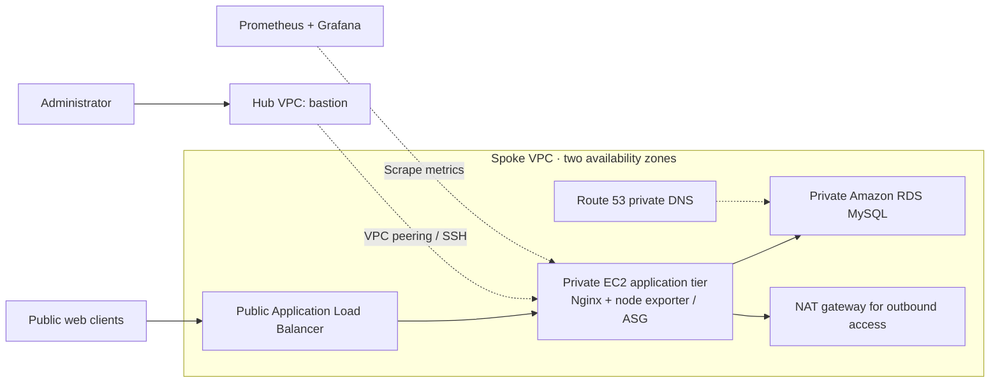
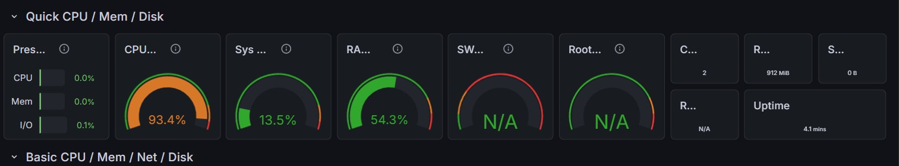

# Case Study 01 — AWS Cloud Infrastructure & Observability

## Objective

Automate the infrastructure of a growing fictional company and design a segmented, resilient AWS environment with private database access and visibility into application health.

## Implemented architecture

- Hub VPC: administrative entry point through a bastion host.
- Spoke VPC: public, private application and private database subnets across two AZs.
- VPC peering supports private management traffic. Route tables and security groups constrain traffic between layers.
- Internet-facing ALB forwards HTTP to healthy Nginx instances in an EC2 Auto Scaling Group.
- RDS MySQL is configured without public accessibility; Route 53 private hosted zone provides a stable internal database name.
- Prometheus scrapes node exporter; Grafana visualizes CPU, memory and other system metrics. CPU-threshold alerting was configured.
- Terraform defines the networks and resources; the original CI workflow is retained for reference.

The [network design drawings](diagrams/network-design-options.drawio) include proposed Transit Gateway and alternate segmentation options. The implemented CS1 snapshot uses VPC peering, not Transit Gateway.

## Validation and lessons

The phase report records active VPC peering, public/private subnet separation, route configuration, bastion administration, private RDS and working Prometheus/Grafana monitoring. Monitoring targets changed status when unreachable. No formal comprehensive pass/fail matrix was supplied for CS1.

The first phase established my Terraform, cloud networking and CI/CD foundation. Key learning points were to design architecture before implementation, divide IaC into understandable files, and allocate more time to unfamiliar services and troubleshooting.

## Source location

The [CS1 source snapshot](../case-study-01/) was recovered from the March 2026 history. It contains `Infra/` (Terraform networking, compute, RDS, Route 53, variables and backend setup), the original GitHub Actions workflow as an inactive reference, and a provider lock file.

## Configuration notes

The historical configuration was written for a specific student AWS account. Review and replace account-specific settings, use a sensitive Terraform input for the database password, and restrict administrative ingress before any redeployment. The publication snapshot replaces the historic literal database password with a sensitive input, uses example state/key-pair settings and requires a restricted administrative CIDR. No cloud resources or Terraform state were changed.

## Historical monitoring evidence

Cropped original screenshot; identifiers removed.
