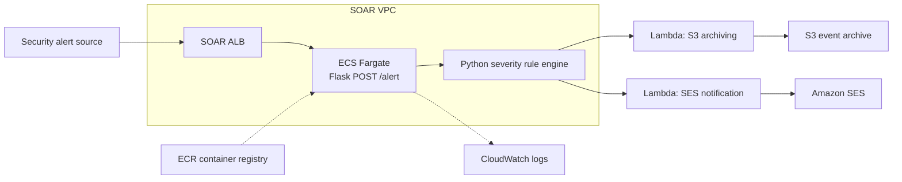

# Case Study 02 — SOAR & Cloud Infrastructure Automation

## Objective

Extend the first phase with automated security-event response while retaining an independently managed web infrastructure and monitoring environment.

## Implemented architecture

The SOAR service accepts JSON over an HTTP endpoint. The rule engine evaluates the severity, then asynchronously invokes Lambda response functions:

| Severity | Action |
| --- | --- |
| HIGH or CRITICAL | Email via SES and archive via S3 |
| Other severities | Archive via S3 |

A separate three-tier infrastructure VPC contains the public ALB, bastion and monitoring server, private application instances behind an Auto Scaling Group, private RDS MySQL and private Route 53 DNS. Prometheus and Grafana are intended to collect and display monitoring data. Separating the SOAR VPC from the application VPC reduces the coupling between stacks.

### Design evolution

The original [target architecture](diagrams/target-architecture.drawio) and [proposed SOAR event flow](diagrams/proposed-soar-event-flow.drawio) include Transit Gateway, EventBridge, SQS, a dead-letter queue and two Fargate tasks. These are **design proposals**, not claims about the implemented snapshot. The implemented alert path uses ALB → ECS → Lambda with a single ECS task.

## Recorded validation

The final test report recorded **7 PASS and 6 PARTIAL** across 13 listed cases. The end-to-end alert response was not successfully verified.

| Test | Recorded result |
| --- | --- |
| SOAR Terraform validation | PASS |
| Infrastructure Terraform validation | PASS |
| LOW alert archive / HIGH alert email + archive | PARTIAL — ALB HTTP 503, ECS image retrieval failure |
| S3 event archive | PARTIAL — bucket existed, no alert objects following endpoint failure |
| Prometheus UI and targets | PARTIAL — connection refused |
| Grafana datasource/dashboard | PARTIAL — unavailable during final validation |
| Application ALB | PASS — earlier HTTP response; repeat test blocked by expired AWS credentials |
| Private RDS and Route 53 | PASS — configuration review |
| GitHub Actions workflows | PASS — configuration review |
| ASG instance auto-replacement | PASS |

The test grouping above condenses the detailed test cases rather than counting rows as separate tests.

## Limitations and next improvements

- Resolve ECR image pull and ECS task startup before claiming live SOAR operation.
- At semester completion, HTTPS, administrative ingress restriction and alert authentication remained improvements; later hardening is described below.
- Enable Multi-AZ RDS and increase ECS task redundancy if required for production.
- Improve SOAR observability with custom metrics and verified dashboard data.
- Avoid applying historical IaC without a cost and security review.

## Source layout

- `cs2-main.tf`, `cs2-variables.tf`, `providers.tf`: SOAR infrastructure.
- `Infra/`: independent application and monitoring infrastructure.
- `soar/`: Python/Flask alert API, rule engine, SES handler, S3 handler and Dockerfile.
- `ci-reference/`: original Terraform and image deployment workflows, kept inactive.
- `diagrams/`: original proposed architecture and event flow (under the documentation directory).

## Configuration notes

The [CS2 source snapshot](../case-study-02/) is based on the May 2026 GitHub implementation and supplied archives, with publication-time hardening. Terraform's archive data sources generate the Lambda ZIP files from the Python handlers, so generated archives are excluded from the reorganized working tree. Review the account-specific remote-state and key-pair configuration in `Infra/`, provide SES sender/recipient variables and database credentials privately, verify ECR image availability and review a plan before provisioning. Historical workflows may perform live deployments; do not run them without reviewing their triggers and commands.

## Post-semester hardening

The diagram and test results above describe the original semester implementation. In the subsequent portfolio revision, the SOAR application now checks a bearer token supplied through an existing AWS Secrets Manager secret, validates JSON types and size, uses a separate health endpoint, and reports asynchronous Lambda requests as accepted rather than as completed. The ALB configuration requires an ACM certificate for HTTPS and a restricted alert-source CIDR. Administrative SSH and monitoring ingress require a trusted CIDR. Alert archive keys now include unique identifiers; SES HTML content is escaped.

The new source requires account-specific configuration: review `terraform.tfvars.example`, provide the certificate ARN and a secret ARN (containing a strong plaintext token), and configure `Infra/backend.hcl.example` and the application variables securely. The original live tests were not rerun following these changes.
