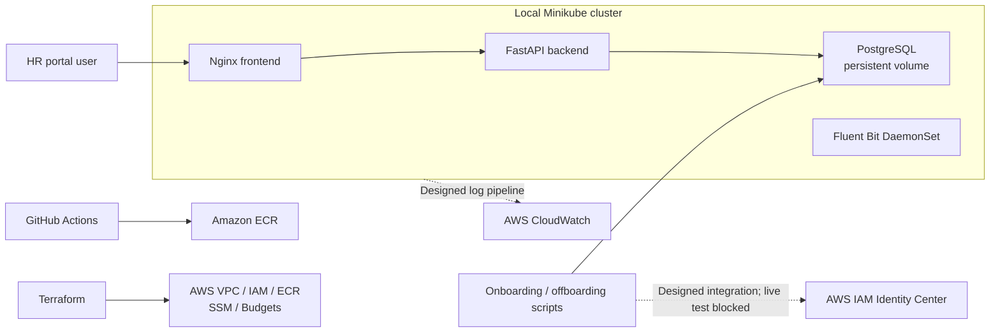
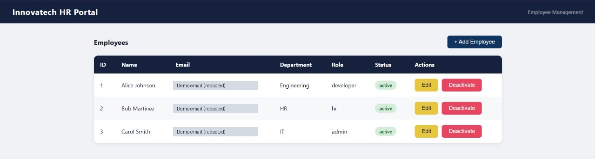
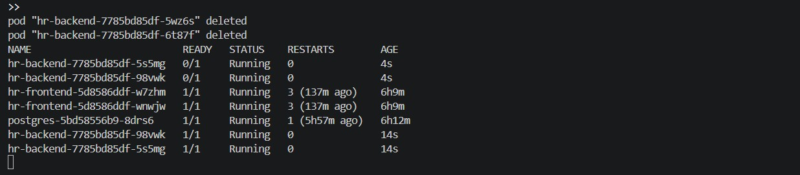

# Case Study 03 — Employee Lifecycle & HR Self-Service Platform

## Objective

Build an employee lifecycle platform combining a containerized HR application, IAM Identity Center automation, Kubernetes deployment, cloud infrastructure, logging and cost governance.

## Implemented and tested architecture

### HR application

The Flask-based SOAR service from CS2 is not reused in the HR portal. CS3 uses a separate FastAPI application and browser-based frontend.

- Create, list and edit employee records; deactivate employees without deleting historical records.
- Persist employee data in PostgreSQL with a Kubernetes PVC.
- Separate frontend and backend deployments, services, ingress, health endpoint and autoscaling configuration.
- Define Kubernetes RBAC and network policies. Application and Kubernetes security boundaries must be reviewed before production use; a demo HR portal is not a production identity or authorization system.
- Provide Python onboarding/offboarding scripts for IAM Identity Center user management, group assignment/removal and database recording.

### Cloud infrastructure and governance

Terraform defines AWS VPC networking, ECR repositories, IAM roles, SSM security baseline and patch configuration, and budget alerting. CloudWatch dashboard configuration and Fluent Bit manifests support observability. GitHub Actions builds Docker container images; the historical CI workflow contains branch-dependent image pushing.

The final runnable workload was on **Minikube**, not EKS. PostgreSQL ran in the cluster, not in RDS. The archived EKS and RDS definitions are in `terraform/unused/` in the tracked final commit.

## Recorded validation — 23 June 2026

The semester test report records 17 PASS and 2 N/A out of 19 test cases. These are historical reported results, not tests run during portfolio preparation.

| Area | Recorded evidence |
| --- | --- |
| HR portal | List, create, edit and deactivate completed; persistence verified after restart |
| Kubernetes resilience | Deleted backend pods recreated; frontend restart tolerance observed; HPA configuration present |
| Logging and monitoring | Fluent Bit pod running; CloudWatch onboarding/offboarding alarms present |
| AWS infrastructure | VPC/network resources, IAM roles, ECR repositories and budget alerts observed |
| CI/CD | GitHub Actions workflow triggered; report records a successful build-and-push run |
| RDS failover | N/A — RDS unavailable under the student account restrictions |
| IAM Identity Center automation | N/A — live execution blocked by a Service Control Policy |

Fluent Bit running does not by itself prove successful log delivery. The available test evidence documents the DaemonSet and CloudWatch alarms, rather than end-to-end live integration with every service.

## Environment constraints and decisions

- **EKS:** local Minikube selected to avoid managed-cluster costs and account restrictions.
- **RDS:** in-cluster PostgreSQL with persistent storage substituted for managed database provisioning; Multi-AZ failover was not demonstrated.
- **IAM Identity Center:** scripts implemented; live user provisioning and removal were not verified due to the sandbox SCP.
- **Production readiness:** HTTPS and load testing were out of scope. The deployment script for the original EKS/RDS design is retained as historical reference only.

## Cost management

The June 2026 cost report records:

| Metric | Historical value |
| --- | ---: |
| Actual spend as of 23 June | $74.21 |
| Forecast end-of-month spend | $95.74 |
| Early warning budget | $35 |
| Development budget | $250 |

The primary drivers were multiple VPC iterations and associated NAT gateways. I reduced expected costs by using Minikube instead of EKS, in-cluster PostgreSQL instead of RDS, and one NAT gateway per VPC for development. The latter creates a single point of failure for outbound traffic and would be reconsidered in production. These are historical figures from the project, not current AWS pricing estimates.

## Source layout

The [CS3 source snapshot](../case-study-03/) was recovered from the final local archive (commit `1cee59b`). Paths below are relative to that folder.

- `app/backend/`: FastAPI API, database connector and Dockerfile.
- `app/frontend/`: HTML frontend, Nginx configuration and Dockerfile.
- `automation/`: onboarding/offboarding scripts, example environment and database initialization.
- `k8s/`: application deployments, PostgreSQL/PVC, job, services, RBAC, NetworkPolicies, HPA, ingress and logging.
- `terraform/`: AWS supporting infrastructure; inactive EKS/RDS definitions in `unused/`.
- `monitoring/`: CloudWatch dashboard configuration.
- `ci-reference/ci-cd.yml`: historical image pipeline, retained as an inactive reference.
- `deploy-local.sh`: historical Minikube deployment helper with the hardcoded demo password removed.
- `ci-reference/deploy-aws-reference.sh` and `aws-ingress-reference.yaml`: original EKS/RDS approach — inactive, not compatible with the active Terraform configuration as-is.

## Local review

For an isolated, disposable demo environment, review `deploy-local.sh` and the Kubernetes manifests first. It is intended for a machine with Docker, Minikube and kubectl configured (run from this case-study directory). Supply a strong `DB_PASSWORD`, plus distinct `HR_ADMIN_TOKEN` and `HR_VIEWER_TOKEN` values of at least 32 characters, privately before invoking it. The local script uses a dedicated Minikube profile and renders image substitutions without editing source manifests. After the script completes, use the printed localhost port-forward command, and sign in using the appropriate demo token. Never use real employee data. Do not run the archived AWS deployment script without reworking and validating the inactive infrastructure design.

## Reflection

Combining infrastructure, containers, application development and lifecycle automation highlighted the importance of adapting to real environment constraints. When managed services could not be used within budget and account policy, I chose practical substitutes, documented their limitations, and kept the main workflow demonstrable. Troubleshooting IAM, ECR, networking and Kubernetes also reinforced the value of allocating time for integration and operational validation.

## Post-semester hardening

The HR API now distinguishes read-only and administrative demo tokens, requires authentication for employee data, and rejects viewer writes. Tokens remain in browser memory and are sent to the same-origin proxy, not URLs or persistent storage. Employee data is rendered with safe text nodes; input roles/statuses are constrained. The network policies explicitly allow backend and database-init traffic to the private PostgreSQL service and deny other inbound/outbound traffic by default. The local script no longer modifies checked-in YAML, uses a dedicated Minikube context and a policy-capable CNI, and exposes the portal only via a printed localhost port-forward command. These are educational safeguards, not enterprise identity federation.

No live deployment was performed for the hardening revision. The historical 17 PASS / 2 N/A results above relate to the original semester version.

## Original evidence

Screenshots are cropped from the original test report.
